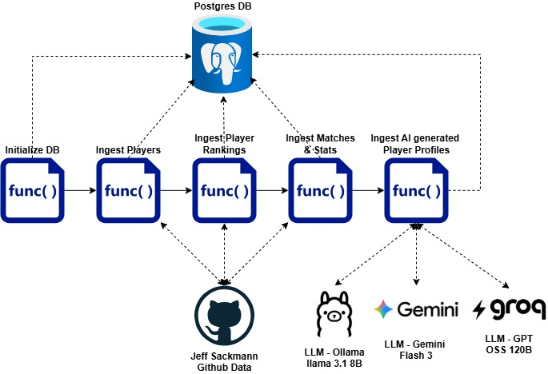
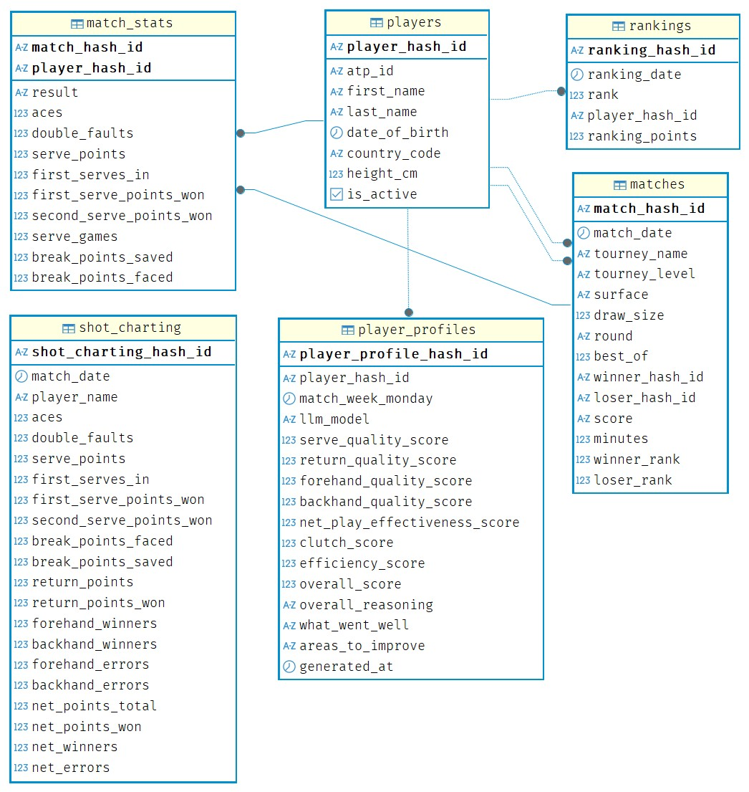

## AI Generated Tennis Player Profiling System

Repository for AI generated tennis player profiling system  

**System Requirements & Pre-requisites & Setup:**    

1. Machine with atleast 16GB RAM
2. Python version 3.12.x
3. Postgres Database installed, up and running
4. Gemini API Key configured at https://aistudio.google.com/
5. Groq API Key configured at https://console.groq.com/
6. Install all dependent python libraries using the command,  
    `pip install -r requirements.txt` 
7. Download llama 8B model using the command,  
    `ollama pull llama3.1:8b`  
8. Set Ollama server environment variables, spin up local service using the script,  
    `.\start_ollama.ps1`

**Data Architecture:**    
   

**LLM Model Options, Tokens Calculation and Configuration:**    
*temperature* - 0.1 , Deterministic and consistent output, minimal hallucination   
*top_p* - 0.95 , Broader choices within the scoring scale, handle edge cases and missing data   
*top_k* - 40 , Ideal for some creativity for the reasoning fields but still stay deterministic   
*system_instruction_tokens* ~ 15  
*scoring_guidelines_tokens* ~ 900  
*input_tokens_per_player* ~ 300  
*Input Prompt tokens for batch size N* = system_instruction_tokens + scoring_guidelines_tokens + (N * input_tokens_per_player) + buffer  
*output_tokens_per_player* ~ 250  
*Output tokens for batch size N* = (N * output_tokens_per_player) + buffer  

***For Ollama,***  

- Async concurrent requests with 1 player per request.   

```json
{
    "num_ctx": 2048, //input_tokens + output_tokens
    "num_predict": 500, //Expected output tokens
    "num_batch": 512, //Number of tokens to process internally in 1 sweep
}
```

***For Gemini Flash,***  

- Batched requests with N players per batch.   
- thought tokens on avg between 1500 - 2800 with occasional spike to 8000 for medium. None or zero tokens for setting at low or minimal.  
- (thought_tokens + output_tokens + buffer) <= max_output_tokens  

So for a free tier 250K TPM,  
GOOGLE_RPM = 3 #batch requests per minute

```json
{
    "batch_size": 10,
    "max_output_tokens": 15000,
    "thinking_config": {
        "thinking_level": "medium",
    },
}
```

***For Groq,***  

- Batched requests with N players per batch.  
- Reasoning effort tokens around 1100 tokens for low and 2800 for medium.  
- max_completion_tokens = reasoning_effort_tokens + output_tokens + buffer
- (input_tokens + max_completion_tokens + buffer) <= tokens_per_minute TPM

So for Free tier 8K TPM,  
"GROQ_RPM" = 1  #batch requests per minute

```json
{
    "batch_size": 4,
    "reasoning_effort": "low",
    "max_completion_tokens": 2400,
}
```

***Caching*** - To maximize the use of cached tokens, always append the dynamic player data at the end of the input prompt. Cached tokens can significantly reduce costs and prevent hitting rate limits(TPM/TPD).

**Run the script:**    
Go to the folder "ai_tennis_player_profile_system" and run the command  

```
python master.py
```

**Power BI - Weekly Score Trends:**    

**Database Schema Design:**    
   